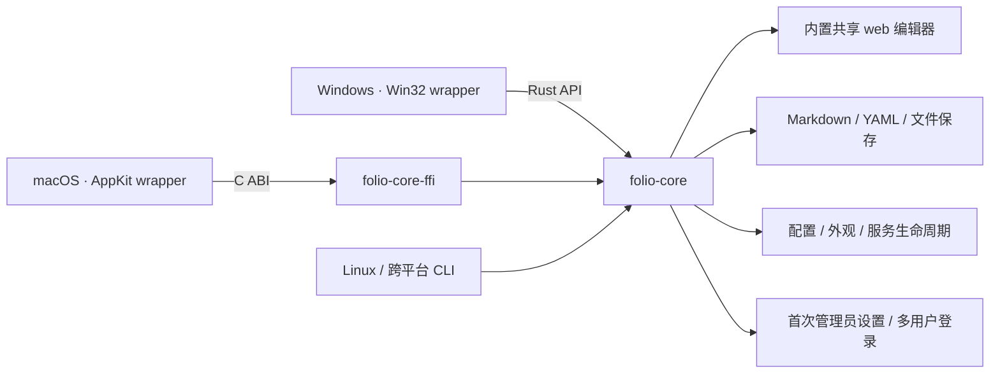

# Folio 使用与开发指南

[English overview](../README.md) · [中文产品介绍](../README.zh-CN.md)

本文保留详细的使用说明、配置、开发命令与数据迁移说明。快速安装和产品概览请先阅读上方 README。

**Folio** 意为书页或文稿集：把零散想法写成自己的知识库。图标以黑白两色的折角纸页结合字母 **F**，无渐变、阴影或叠层。

基于 **folio-core + 平台薄壳** 的轻量本地 Markdown 编辑器。Windows、macOS 和 Linux CLI 共用同一份 Rust 核心与网页编辑器；系统默认浏览器提供保留排版的 Live 编辑。

**不依赖 Python、MkDocs、.NET、Windows App SDK 或 WebView2，也不打包浏览器。** 笔记仍然是自己目录中的 `.md` / `.markdown` 文件，不导入数据库、不上传云端。

## 安装 0.1.0

仓库：[HSPK/folio](https://github.com/HSPK/folio)。[GitHub Releases](https://github.com/HSPK/folio/releases) 提供 Windows、macOS 和 Linux 的 x64 / ARM64 构建；安装不需要开发工具或管理员权限。

Linux / macOS：

```sh
curl -fsSL https://github.com/HSPK/folio/releases/latest/download/install.sh | sh
```

Windows PowerShell：

```powershell
irm https://github.com/HSPK/folio/releases/latest/download/install.ps1 | iex
```

脚本自动识别架构，下载发布包并核对 `SHA256SUMS`；下载或校验失败不会覆盖已有程序。也可以先下载、检查脚本内容，再执行，或直接从 Releases 手动安装。

| 平台 | 默认安装位置 | 启动 |
| --- | --- | --- |
| Linux | `~/.local/bin/folio` | `folio --serve /path/to/markdown` |
| macOS | `~/Applications/Folio.app` | `open ~/Applications/Folio.app` |
| Windows | `%LOCALAPPDATA%\Programs\Folio\Folio.exe` | 开始菜单 Folio，或新终端中执行 `folio` |

Linux 用户需把 `~/.local/bin` 加入 PATH；若尚未配置，安装脚本会提示。Windows 安装脚本创建开始菜单快捷方式并更新用户 PATH。macOS 构建仅使用 ad-hoc 签名，尚未公证；首次运行可能需要在「系统设置 → 隐私与安全性」中批准。脚本不会禁用 Gatekeeper。更新前请保存未保存文本并退出旧程序。

固定版本或指定安装目录：

```sh
curl -fsSL https://github.com/HSPK/folio/releases/download/v0.1.0/install.sh |
  FOLIO_VERSION=0.1.0 FOLIO_INSTALL_DIR="$HOME/.local/bin" sh
```

```powershell
$env:FOLIO_VERSION = "0.1.0"
$env:FOLIO_INSTALL_DIR = "$env:LOCALAPPDATA\Programs\Folio"
irm https://github.com/HSPK/folio/releases/download/v0.1.0/install.ps1 | iex
```

`FOLIO_INSTALL_DIR` 在 macOS 表示放置 `Folio.app` 的父目录。`folio --version` 显示版本（Linux / Windows CLI）；桌面应用的版本信息也为 0.1.0。

推送 `v*` tag 会触发 `.github/workflows/release.yml`：六个平台构建全部成功后，统一发布对应 archive、两个安装脚本及 SHA-256 校验清单。安装脚本的离线回归测试可运行 `npm --prefix web run test:installers`。

## 架构



| 目录 | 职责 |
| --- | --- |
| `crates\folio-core\` | 共享服务、用户认证、Markdown/YAML 渲染、受限文件访问、版本冲突保护、配置和 `FolioCore` 控制器 |
| `crates\folio-core-ffi\` | 将控制器暴露为小型 C ABI，供 Swift 等宿主调用 |
| `crates\folio-cli\` | 跨平台命令行适配器，负责参数、退出信号及诊断文件，不包含桌面 UI |
| `web\` | SolidJS / TypeScript / Kobalte 浏览器应用壳、API 状态管理、Vite 生成资源和端到端测试 |
| `web\editor\` | 独立 `@folio/editor` package，包含 Milkdown、CodeMirror、KaTeX、Markdown 语义、滚动条、单测和性能基准 |
| `apps\windows\` | Win32 托盘、设置窗口、配置路径显示、系统浏览器/文件管理器调用 |
| `apps\macos\` | AppKit 托盘和设置窗口，通过静态链接的 C ABI 使用同一个 core |
| `Shared\Resources\` | 共用的 SVG、PNG 和 ICO 图标 |

平台壳不再启动 MkDocs 或实现另一套文件/渲染逻辑。新增 Rust 宿主可调用 `FolioCore::new`、`save_settings`、`start`、`stop` 和 `open_url`；其他语言使用 `crates\folio-core-ffi\include\folio_core.h`。C ABI 返回的字符串必须由 `folio_core_string_free` 释放，句柄须串行使用并在退出时释放。文件访问的 Windows handle / Unix descriptor 适配仍由 core 统一管理。

## 桌面使用

1. 双击 `Folio.exe`，应用自动准备本机工作区并启动服务，无需先选择笔记目录。原生 Settings 显示配置文件地址，保留端口、启动选项和外观设置。
2. 首次打开浏览器时创建本机管理员账号；Windows、macOS 和 Linux CLI 共用同一套网页设置及登录流程。
3. 登录后在 Projects 中创建项目，或由管理员选择 Existing server folder 接入已有目录；Settings → Project files → Projects 也可打开项目管理。选择笔记后直接编辑排版后的正文。
4. 停止输入后默认 1 秒自动保存，也可按 **Ctrl+S** 立即保存；未保存修改用页面标题及浏览器标题中的 `*` 表示，保存完成后自动消失。底部不显示 Saved 或未保存的常驻文本，仍保留保存中、只读、冲突和错误提示。关闭浏览器不会停止服务；左键点击托盘图标直接打开网页，右键打开菜单。

笔记目录在 WebUI 的 Projects 中管理，不再从原生设置修改。更换端口前，需要先从托盘停止当前服务；保存后再启动。关闭或重启服务前请先保存浏览器中的修改。

Settings 按 Writing preferences、Current project、Advanced 和 Administration 分组，写作、外观、布局、快捷键及辅助功能前置；Project files、Synchronization、Performance tuning 与管理员的 User management 明确区分范围。首次打开默认进入 Writing，再次打开保留当前会话上次查看的部分。窄屏使用分组 Section 选择器，不横向截断桌面标签；桌面目录支持上下方向键及 Home/End。主题、字体、字号、行高、自动保存、默认视图、隐藏规则、刷新间隔和性能选项由本地服务共享并原子持久化；页面宽度、侧栏宽度和快捷键同时保留浏览器本机覆盖。字体只使用本机已安装的字体，不下载网络字体。

搜索设置时会自动滚动到匹配的设置行并突出显示，搜索框继续保持焦点；清空查询会恢复搜索前的分类和滚动位置。搜索既支持具体设置名称，也支持分类名称。

新建笔记、切换笔记或项目时，先保存当前内容并等待已经进行中的保存完成，包括协作保存；成功后继续原操作，不再要求丢弃尚未触发自动保存的文字。等待过程中继续输入会取消导航并保留新文字。保存失败时可选择重试、继续编辑或明确放弃本地修改；冲突不会被强行覆盖。已经保存完成的过期确认会自动结束，明确选择 Reload from disk 时仍保留丢弃修改的确认。

不需要 `mkdocs.yml`、虚拟环境、预先构建站点或启动其他服务。支持文件夹导航、筛选、新建笔记、标题大纲、列表、任务列表、引用、代码块、表格及相对图片/笔记链接。页面跟随浏览器的明暗主题，所有编辑器脚本随 EXE 内置，无 CDN 依赖。小型 Source 文档使用原生 textarea；达到配置的字节阈值（默认 768 KiB）或超过 4000 行时切换到 CodeMirror 虚拟编辑器，避免密集长文档的整篇原生布局开销。

界面是一张连续的写作页面：顶部菜单直接显示当前 Live、Source、Compare 或 Read 状态，并用轻量展开箭头明确表示可以切换；协作状态显示 Collaborating，窄屏显示在线人数，不再用 Sharing 混淆公开分享权限。设置位于右上角的 **More（…）→ Settings**，也可从侧栏底部打开，不单独占用顶部工具栏按钮。更多菜单分为 Current note、Workspace 和固定的应用操作区，History and recovery 按需展开；即使短窗口中内容滚动，Settings 仍可直接访问。第三方许可证位于 More → About Folio。更多菜单使用清晰的三点图标和轻量圆角底色，支持键盘操作；关闭设置后焦点返回入口。Live 空段落输入 `/` 可选择标题、列表、引用、代码块、表格和分隔线。斜杠和后续输入保持正常可见，继续输入可筛选命令（如 `/heading 2`、`/h2`）；选中命令时才移除查询文字，Esc 关闭菜单但保留原文。命令面板按钮默认隐藏，仍可用 `Ctrl+K` 或自定义快捷键打开。左侧保留笔记导航和文件树，可以隐藏或拖动边界调整宽度；文档大纲移到右侧，默认显示标题短线，悬停或键盘聚焦时展开，点击可固定展开，Esc 关闭。窄屏支持点按打开和跳转后关闭，大纲不依赖左侧栏是否展开。

| 快捷键 | 操作 |
| --- | --- |
| `Ctrl+S` | 保存 Markdown |
| `Ctrl+Shift+L` | 显示/隐藏左侧栏 |
| `Ctrl+Shift+1` | 显示大纲 |
| `Ctrl+/` | 切换完整源码和实时编辑 |
| `Ctrl+K` | 打开全局命令面板 |

文件列表只占一个 Tab 停靠点：`↑`/`↓` 移动，`←`/`→` 折叠或展开目录，`Home`/`End` 跳到首尾，`Enter` 打开，直接输入字符跳到匹配的名称。在 Search files 中按 `↓` 进入结果、`Enter` 打开第一个匹配、`Esc` 清空过滤。按下鼠标时即开始预取目标文档；大文档先显示选中状态和标题，再在下一帧加载格式化编辑器，加载期间顶部显示细进度条。

文件树采用紧凑行距和逐级缩进，为深层目录保留更多文件名空间；触摸屏仍保留较大的点击区域。快速连点不会选中文字，不影响展开、键盘导航或拖放移动。

文件树显示安全的空目录。文件和 `index.md` 的 YAML `title` 会替代物理名称作为显示标题，没有标题时显示不含 `.md` 扩展名的文件名；物理路径用于悬停提示、读屏名称和磁盘定位，文档 URL 使用独立的资源 UUID。通过链接、搜索或浏览器前进/后退打开笔记时，文件列表会滚动到当前文件。将鼠标移到文件夹标题可在该目录中新建笔记或子目录；文件右键可查看详情或重命名，文件和目录可拖入其他目录。移动和重命名遇到同名目标时会拒绝操作，不自动覆盖。

如果当前笔记不在文件筛选结果中，侧栏会说明原因并提供 Show current note；点击后才清除筛选并定位当前笔记，不自动改掉用户的查询。只有显示标题重复时，列表才补充次级相对路径；重复消失后恢复紧凑单行显示，重命名和标题编辑会同步更新相关行。

浏览器标题优先显示文档的 YAML `title`，没有标题时显示文件名而非完整路径，未保存时仍带 `*`。新建笔记只需填写 Title，无需路径或扩展名；默认放在当前文档所在目录，也可从目录操作指定位置，表单会预览生成的文件路径。文件名保留 Unicode，替换不兼容字符并限制 UTF-8 长度，重名时明确提示，不覆盖已有文件。所有新建模板（包括空白笔记）都写入 YAML `title` 和 `created`；`created` 是创建时浏览器生成的 UTC ISO 8601 时间，普通编辑、保存和移动不会改写它。日记、周记和会议模板继续保留日期、标签和正文；切换模板不会覆盖已填写的自定义标题。

保存中只显示 `Saving…`，新输入仍由标题的 `*` 标记。保存请求未完成时再次按 `Ctrl/Cmd+S` 会排队保存最新文本，而不是直接忽略。请求超时会退出等待并保留正文；重试前核对磁盘是否已写入上一快照，避免因响应丢失误报冲突，也不会覆盖不同的外部修改。

Settings 的 Project files 页面支持按相对路径 Glob 隐藏文件和目录，每行一条，例如 `drafts/**`、`*.private.md`，并可配置自动刷新。`*` 不跨目录，因此 `*/index.md` 只匹配一级子目录；`**/` 匹配零层或多层目录，使用 `**/index.md` 可隐藏 Project 根目录及所有子目录中的 `index.md`，`docs/**/index.md` 则覆盖 `docs/index.md` 及更深层的同名文件。规则不能重新显示 core 强制排除的隐藏目录、依赖目录、符号链接或联接目录。

项目设置、创建、移动和标签修改等常规成功操作不额外显示全局确认文案；复制链接成功时按钮直接显示 Copied，表单内同时提供读屏反馈，不弹出全局消息。错误、警告和必要的执行中状态仍明确显示。

按钮、侧栏切换项、菜单和列表统一使用 6px 圆角及轻量底色区分悬停和选中；键盘焦点另外使用内侧轮廓，不再只依赖相近灰底。主操作按钮跟随当前主题统一为黑白配色，工作区弹窗统一使用带可访问名称的关闭图标。输入框使用完整的内侧细边，Live、Source 和 Read 正文保持无外框。Live 中 Ctrl+点击选中段落、标题等块时不添加底部装饰横线，块选择及 Ctrl+点击打开链接的行为保持不变。系统强制高对比模式仍保留清晰焦点轮廓。侧栏底部不重复显示目录名和笔记数量，刷新文件入口位于侧栏顶部，目录信息仍可在 Settings → Project files 查看。

侧边栏、正文、源码和预览使用细浮动滚动条：滚动或移动鼠标时显示，闲置后淡出，不占据正文宽度；溢出出现/消失不会挤动布局。仍可使用滚轮、键盘、触摸和拖动滑块滚动；高对比度模式下保留清晰的滑块。

笔记始终保存为 **Markdown 文件**。Live 模式在保留排版的页面里编辑；需要精确操作语法时，可切换 Source、源码与预览对照的 Compare，或只读的 Read。加载、连接、保存中、只读、冲突及错误消息统一显示在浮动列表，可换行和滚动，不挤进最下面一行，也不改变正文或侧栏高度；底栏仅保留字数等统计和操作入口，未打开笔记或保存完成时不显示常驻提示。列表通常位于右下角，弹窗、菜单或图片面板打开时自动避让操作区，窄屏不会盖住保存按钮。非关键消息可以收起或单独关闭；新的提示仍会重新显示。真正的错误始终展开，不随其他消息折叠，也不能通过关闭提示跳过；表单错误保留在当前弹窗及遮罩上方。

列表中 `Shift+Enter` 产生的末尾空行按 `Shift+Tab` 时，只提出该空行，保留前一项的圆点、编号、任务状态和内容；此操作可单步撤销。普通非空列表项的退一级操作及嵌套列表行为保持不变。

图片可以直接成为列表项的首个块，不再为了满足段落约束制造可见空行。圆点、编号和复选框与首张图片对齐；插入图片前后的文字、嵌套、取消嵌套、任务状态及撤销仍使用原生节点和事务。将列表项唯一的图片移走时，同时移除腾空的列表项，保留其他条目。

### Projects 与共享

文档、目录和附件采用独立生成的 UUID v7，用户模式存储在项目工作区 SQLite 中；不是路径、标题或内容的哈希。文档地址使用 `/?project=<project-id>&document=<uuid>`，文档 API 使用 `/api/document?id=<uuid>`，附件使用 `/assets?id=<uuid>&document=<source-document-uuid>`。创建、重命名和解析 Markdown 相对链接的请求体仍携带路径；旧 `file`/`path` 文档 URL 不提供兼容转换。项目 ID、历史版本序号和公开分享令牌各自保持其原有用途，UUID 本身不授予访问权限。

应用内移动保持资源 UUID，删除后在同路径新建不会复用旧 UUID 或其历史，回收站恢复则使用被回收资源的身份。Markdown 源文档仍保留可移植的相对路径；渲染时解析为资源 URL。外部 Git/文件管理器移动不做内容相似度匹配，无法确认身份时不会猜测新位置。诊断 token 模式的身份表仅存在于当前服务进程，不提供跨重启书签保证。

用户模式下，侧栏底部的项目名称打开贴近入口的紧凑 Projects 浮层，采用低对比背景、无卡片边框和无图标底座的扁平列表。可搜索和切换项目；底部 New project 在同一浮层内创建私有目录项目，管理员还可接入已有的服务器绝对目录。配置采用紧凑属性行；点击外部可关闭，未保存内容仍有保护。浮层自动避开屏幕边缘，不跳转整页，也不清空或重新加载原笔记；再次选择当前项目直接关闭浮层。项目以本地文件夹存储 Markdown；不能接入 Folio 的账户存储目录或与已有项目重叠的目录。原 CLI `--serve` 目录首次访问时迁移为初始管理员拥有的私有 `default` Project，其他用户不再自动获得访问权限。诊断 token 模式保留单目录行为。

Projects 中的设置图标可修改名称、图片目录和面向**所有已登录用户**的共享权限：不共享、只读或共同编辑。列表、新建、项目设置和 Page permissions 在同一个弹窗内原位切换，返回按钮回到上一视图。未保存表单的确认替换当前内容，不保留旧表单叠在下面，也不额外打开提示框。单篇笔记也可从 More → Share page 进入 Document permissions，选择继承 Project、仅所有者可见、登录用户只读/编辑或公开链接。独立文档权限优先于 Project 权限；所有者始终保留管理和编辑权限。恢复 Inherit Project permission 会移除该文档的独立规则及公开链接。删除和重置链接等确认同样在当前界面内处理，不叠加二级窗口。

管理员可在其拥有项目的设置中修改 **Folder path**，使用已有的服务器绝对目录，仍执行存储保护和项目目录重叠校验。保存只更改项目指向，不搬移、覆盖或删除原目录中的文件；项目身份、名称及共享规则保留，当前项目的文件树自动刷新。更换目录会结束旧的协作连接，未保存笔记仍需确认；尚未落盘的协作修改会阻止更换。

公开分享仅针对单篇文档，选择 Public link 并保存后生成免登录链接，**默认匿名只读，且不加入协作房间**。单独勾选 Allow anonymous editing 并保存后，访客可编辑；另一位获授权编辑者打开同一文档时，才启动 Live、Source、Compare、Metadata 和图片粘贴的实时协同，显示临时 `Guest` 身份与彩色光标。公开链接不会开放项目列表、其他文档或账户设置；只读限制同时由 HTTP 和协作准入校验，而非仅禁用编辑器。

公开会话建立时只读取并验证源文档，HTML 在实际取文档时生成，避免打开链路重复渲染。命中已有文档缓存时可仅复制源文档字段，不复制 HTML；缓存读取仍重新检查文件指纹，外部修改、无效内容和已删除文件不会被忽略。

访客会话按到期时间索引清理，避免每次建立会话扫描所有尚未过期的记录；旧数据库会自动补建该索引，不改变会话期限、密码校验或 SQLite 持久化级别。

公开链接相当于访问凭据，应只发给需要访问的人。所有者可切换为非公开权限来关闭链接，或选择 Reset public link 生成新链接；旧链接、旧访客连接随后失效，降为只读也会更新已连接访客的编辑权限。链接会跨服务重启保留，不默认设置过期时间。公开分享不会自动将本地服务暴露到公网，接收方仍需要能访问当前服务地址，例如使用既有 SSH 转发。

单页接收者只能读取该页及所有者批准的附件；新粘贴图片随该页授权，手工新增已有附件引用后可重新保存文档权限来更新附件清单。私有文档不会出现在其他用户的文件树或目录标题中，其正文与附件受保护。已有独立权限的文档移动前需要恢复继承，非所有者在项目有独立文档权限时不能移动目录。

Project 的文件、缓存和协同房间彼此隔离；共享设置持久保存，撤销访问后现有协同连接也会停止接收更新。只读用户仍可实时查看、选择和复制内容，但不能编辑、创建页面或上传图片。共享管理仅项目所有者可执行。改密码不改变项目归属，删除账户后重新注册同名用户不会继承旧项目。

应用不提供仓库克隆、提交、推送或后台同步。旧项目继续使用原本的本地目录；旧仓库、附件、共享规则和笔记历史不会被删除，废弃的仓库凭据及同步字段不再写入项目配置。

### 图片与表格工具

Live 空白笔记显示轻量的输入提示。`/` 菜单提供 Task list、Image 和 Formula；图片通过原生文件选择器上传，取消或失败时保留查询文字，不先删掉 `/image`。插入块作为一次可撤销操作提交；无匹配时明确提示，并允许继续输入普通文本。命令面板也提供这些插入动作，以及 Search notes、Favorites and recent notes、Rename current file 和 Version history，按当前视图与权限显示。

在 Live、Source 或 Compare 的编辑区使用 **Ctrl/Cmd+V** 可粘贴剪贴板中的 PNG、JPEG、GIF、WebP 图片，服务验证图像后生成不重名文件并插入相对 Markdown 引用，协同编辑者会同步看到图片。单张最多 16 MiB；图像解码还有尺寸与内存上限，不能用图片上传任意文件或覆盖已有文件。

Live 图片粘贴优先使用编辑器原位事务，保留当前段落、光标和撤销历史，不重新加载整篇正文。单张图片粘贴到已有文字中时使用行内节点；粘贴到空段落、块间或一次插入多张图片时使用独立块级节点。图片后的空段落使用 Markdown 空白，不生成 `<br />` 占位；代码块中的字面 `<br />` 保持原样。

默认图片目录为 Project 根目录下的 `assets/images`，可在 **Settings → Project files → Pasted image directory** 或 Project 的 Manage 中修改。只允许安全的项目内相对路径，所需子目录自动创建，不会沿符号链接写到项目外。只读页面不允许粘贴上传。斜杠菜单使用紧凑圆角列表，支持鼠标、上下方向键、Enter 和 Esc，打开菜单不会把焦点移出编辑器。

图片也可拖放到 Live / Source 编辑区的指定位置。Live 文件拖放插入独立图片块；落在已有图片的上半部或下半部时分别插入其前面或后面，不会替换原图片。Settings → Project files 可设置最大边长、无损 WebP 压缩或白底 JPEG 及其质量；默认不修改原图，不放大图片，动画保留原始文件。未缩放且转换后更大的图片会保留原文件，并明确提示。

Live 中悬停图片时，右上角显示紧凑图标栏，提供尺寸/布局、替换和另存为等常用操作，清晰的 `…` 中保留复制引用和移除图片；移除引用不会删除原图文件。点击图片后显示选中边框与缩放手柄，选中时工具栏可以保持打开，回到正文或元数据输入时自动退场。图片设置宽屏停靠在编辑区右侧，窄屏停靠底部，并为正文分配真正独立的可视区域，不压住后续段落。Inline / Left / Center / Right 和常用宽度比例可以直接操作；Custom size 按需展开像素或百分比宽高及原子 Apply。拖动图片角部按比例缩放，松开时只提交一次可撤销修改。仅当需要尺寸或布局时才自动使用受限的 `` HTML；重开、预览、协作、附件引用和移动后的相对路径仍保持一致。替换只修改原图片节点，后台上传结束不会抢走正在输入文字的光标；切换文档或更改目标图片后不会误替换新内容。只读页面保留下载和复制，不提供修改操作。

图文编辑采用三种明确的原生选区：文字插入点、图片节点选中和块间插入点，不在正文之外绘制模拟光标，也不插入隐藏字符。独立 Markdown 图片及 Left / Center / Right 布局使用与段落同级的 `image_block` 节点；句中图片仍使用真正的行内节点，不再把行内节点通过 CSS 伪装成块。独立图片没有自定义尺寸且左对齐时仍保存为普通 Markdown，打开文档不会改写原文件。切换为块级布局时，在图片位置拆分段落并保留两边文字；明确切回 Inline 时使用受限的 `display:inline` 标记持久保存选择，重开和预览不会重新变为块级。表格等只接受行内内容的位置不能直接转换为块级图片，操作会明确提示，不会移走或丢弃单元格内容。

选中块级图片后，左右或上下方向键移到相邻文字或原生块间插入点；只移动光标不会改写 Markdown。图片前后、连续图片之间及文档首尾均可进入可输入位置。选中图片或处于块间插入点时按 Enter，会创建真正的文字段落；中文输入使用浏览器与 ProseMirror 原生输入法路径。文字边界处按 Backspace / Delete 先选中相邻图片，再按一次才移除，降低误删风险。拖动图片按文档流调整位置，可落在另一张图片前后；使用原生落点提示，不会重复上传，移动独立图片不会遗留空段落。布局转换、缩放、移动及删除均通过可撤销事务完成。

悬停 Live 表格只显示轻量工具入口，不改变正文可视区域。选择单元格或明确点击 Table tools 后才展开底部停靠面板，并让当前光标保持可见。关闭面板后，在同一表格里继续输入不会自动重新展开；工具入口可随时再次打开它。Rows / Columns 可在当前正文行列前后插入或删除，Column alignment 调整整列对齐；表头保持首行，只允许在其后插入正文行，不允许直接删除表头、最后一个正文行或最后一列。结构与对齐修改可以撤销。Copy as 按需展开 Markdown、HTML 源码、CSV、TSV 或 JSON 行数组；只读文档仅允许复制。CSV/TSV 正确引用分隔符、引号和多行单元格；JSON 保留重复表头，HTML 转义单元格中的字面标记，不执行脚本。复制不会改写正文。

### 链接识别与编辑

输入、粘贴及重新打开笔记时，自动识别 HTTP/HTTPS 网址、`www.` 网址和邮箱，保留原来的显示文字。Live 与 Read 都支持这些形式；代码块、行内代码、图片文字以及已有的显式链接目标不会被自动覆盖，中文句读和网址后的标点不会被吞入链接。识别过程不访问外部网址，也不抓取网页标题或预览。

Live 中普通点击和拖选链接保持原生文字选择，不自动打开模态窗口。悬停或单击时的轻量 Link actions 提供 Open、Copy 和明确的 Edit 入口；也可通过命令面板的 Edit current link 编辑当前链接。拖选过程中不会显示操作条或抢走焦点，Ctrl/Cmd+点击仍可直接打开。编辑目标后先 Apply，再打开或复制，避免误用旧地址。只读文档只能查看 Details、打开和复制，不能修改链接。不可访问的笔记使用不同样式，并在选项中解释状态，不直接弹出底层文件系统错误。只有具有创建权限且能确认目标不存在时，才提供 Create note；先保存当前笔记，再预填目标目录和标题，仍由用户确认创建，不绕过权限或覆盖已有文件。

Live、Source、Compare 与 Read 切换时保留对应的源码位置；修改源码后回到 Live 不再跳回文首。在 Read 滚动后切回编辑，定位到正在阅读的正文块。预览位置标记由共享 Markdown 渲染器生成，不写入原 Markdown 文件。

文件和目录的右键菜单显示操作对象，打开后方向键只移动菜单项，Escape 返回原对象；目录也支持重命名。Rename file 明确只改物理文件名，不自动修改 Properties 中的显示标题；名称未变化时禁用提交，更新 Markdown/wiki 引用仍可选择。

### 标签、全文搜索与工作区

窄屏顶栏合并协作头像与人数为在线人数入口，读屏名称保留参与者信息；Page width 移至 More 菜单，优先保留文档标题。桌面仍显示头像和独立页宽入口。

图片快捷对齐与 Custom size 的 Layout 保持同步；切换对齐不清除尚未 Apply 的宽高输入。分享链接尚未创建或权限表单有未保存修改时，Copy link 不可用；保存后可复制，失败原因在表单内部显示，不浮盖密码等字段。

Properties 支持 `tags: [research, 中文]`，兼容单个 `tag`。展开后可直接编辑 Title、Status 及新增/移除标签；没有 YAML 头的笔记可通过 More → Edit tags 添加。常用属性只修改对应 YAML 值，保留注释、字段顺序、未知字段和正文；结构化属性、锚点及带逐项注释的标签列表通过 Edit YAML 修改，避免丢失原有结构。每篇最多 64 个标签，每个最多 80 个字符，大小写相同的标签会去重。

侧栏提供 Search notes 和 Favorites and recent，文件树输入框明确标记 Filter files；更多菜单与 **Ctrl/Cmd+P** 仍保留全文搜索入口。点击标签也可打开搜索，可限定当前/所有可访问 Project，以及标题、正文、Metadata；多个标签组合过滤。窄屏默认折叠 Filters，已选标签仍可直接移除。搜索和标签统计均执行最新的文档权限检查，也遵守隐藏路径规则；匿名公开页面不能浏览工作区搜索。首次搜索分批建立 SQLite FTS 索引，后续按文件指纹增量更新。结果默认展示可读正文摘要，不混入 YAML 头、链接地址或 Markdown 标记；元数据命中单独标注 Metadata match，打开后准确定位原始 YAML。输入新查询时旧结果暂不可点击或回车打开，Searching notes 在输入框附近显示，不收进全局消息；新结果可用上下方向键选择、Enter 打开。

空查询和标签浏览不会为所有匹配笔记加载正文，只按需读取最多 100 条可见结果的摘要来源；标签统计仍覆盖全部有权限且符合筛选条件的笔记。标题、正文和 Metadata 查询只读取需要的匹配字段，权限与文件指纹仍逐项检查。索引保留逐篇事务，避免批量写入长时间占用工作区存储；取消请求时同时回滚文档行和全文索引，扫描进度不会跳过未提交项。

More → Favorites and recent notes 提供收藏和最近访问，菜单文字会显示当前可执行的添加/移除收藏操作。不再显示多文档标签栏或固定标签功能；打开笔记不会累积标签，也不受旧版 128 个标签的限制。More 菜单分组显示，短窗口内可滚动访问全部操作；窄屏 Settings 使用可横向滚动的分类栏，底部保存与取消按钮保持可见。数据按账户保存在服务端，可跨浏览器恢复；当前打开的笔记保留在各浏览器本机，新浏览器默认打开最近访问的笔记。最多保留 512 个收藏和 100 个最近访问项，切换账户不会把上一账户的编辑内容带入新账户。旧版标签记录保留在存储中用于兼容，但不再出现在界面。

重复记录同一最近访问项或重复设置收藏时，若保存状态完全相同，就保留原 revision、不提交数据库写入；标题、顺序或实际内容变化仍原子保存。跳过写入不会跳过当前文档的访问权限检查。

SQLite WAL 可用时，工作区读取和访客凭据查询使用独立只读连接，读取当前已提交快照，避免等待索引写入；未提交数据不可见，也不缓存工作区内容或授权结果。访客凭据仍逐次校验，并在查询完成后检查到期时间。写入仍使用 FULL 同步。WAL 不可用时保留原串行路径并明确记录提示，避免改变不支持 WAL 的存储行为。

收藏/最近访问窗口先显示当前账户已加载的数据，再异步刷新；刷新失败会在状态区提示。Rust 记录工作区标题时只读取和验证 Markdown 源文档，不渲染正文。Live 和 Source 首次读取使用 `/api/document?id=<uuid>&render=source` 获取源码与元数据，`html: null` 表示未预先渲染，不为编辑模式重复生成和传输 HTML。Read/Compare 实际需要时才获取或构建预览，保存响应中已带回的有效 HTML 仍可复用。默认文档 API 继续返回完整 HTML；文档或编辑版本变化会使旧预览失效。

Live 对普通段落和标题采用增量序列化，复杂结构仍使用完整序列化路径；正文光标映射按需构建，隐藏的大纲不额外解析或更新 DOM。预检 AST 可供编辑器解析器复用，但通过副本隔离 remark 变换；只有语法节点之外的末尾换行差异可复用原有序列化校验树，代码和 HTML 字面内容仍完整校验。Rust 对已渲染文档继续复用 JSON 响应。

重复打开正文时，仅缓存纯 AST、已验证的文档 JSON 和序列化校验结果，按条目数、正文大小及估算内存权重限制并淘汰；不缓存活的编辑器、DOM、schema 或撤销历史。每次仍重新读取并检查文件身份、权限、版本和指纹，并在当前 schema 中创建独立节点和编辑状态、按当前路径解析相对链接。切换时先停止旧视图观察器，再移除旧 DOM；浏览器拒绝 URL 历史提交时保留原文件、正文和保存目标，明确显示错误。

Live 正文与代码块的自定义滚动控件在首次指针、焦点或滚动交互时建立，之前保留可用的原生视口；强制高对比模式立即建立控件。冷的大文档保留先显示切换反馈的绘制机会，已缓存的正文不额外等待这一帧。不支持安全往返的 Markdown 始终回到 Source，重复尝试 Live 也不会复用未就绪视图。

大纲跳转在 Live 中通过当前标题 ID 直接定位现有编辑器节点，不为跳转重建全文源码坐标映射；Source 由原生文本框或虚拟编辑器按实际换行布局定位，Read 也直接滚动、不等待动画。标题高亮通过索引更新原有按钮。协作光标等通用源码定位仍按需使用坐标映射。

不含 HTML 图片的普通正文，Rust 预览渲染仍通过单次 Markdown 解析同时生成正文与标题锚点，只缓冲当前标题的行内事件。含 HTML 图片时，仅额外预处理严格校验过的图片标签，保留相邻 Markdown、代码字面内容及原始链接位置，再共用原有渲染链路。重复标题编号、Unicode 锚点、链接重写及其他 HTML 转义规则保持不变。切换文档时，Source 滚动复位与同一帧的界面更新合并，避免中途强制布局；过期文档的回调不会影响新文档。

### 输入延迟自测

先保存或备份当前正文，再在当前 Folio 地址的查询参数中加入 `perf=1`（已有参数时使用 `&perf=1`，放在 `#` 锚点之前）。只有显式启用时才加载诊断脚本；普通页面不启动采样。

在 Safari 的 Web Inspector 控制台中运行 `folioPerformance.reset()`，回到编辑器自然输入 30 秒，每个场景最好累计至少 100 次输入，再运行 `folioPerformance.report()`。`folioPerformance.download()` 可将报告下载为本机 JSON；`folioPerformance.stop()` 停止采样，`start()` 重新开始。报告只保留最近 512 次输入的时间、模式、字节数及大纲/协作等状态，不记录正文、按键字符、文档名称或地址，也不上传。

报告按 Live/Source、单人/协作、大纲开关及输入法组词状态分组。`inputToModel` 是浏览器 `beforeinput` 到编辑状态同步的耗时；`inputToFrameOpportunity` 是到下一帧机会的估算，能包含状态同步后的主线程工作，但不是硬件屏幕真正呈现像素的时间。应比较 P50、P95 和长帧，不能只看平均值或保存请求；不足 100 个样本不输出 P99。

浏览器若支持 Event Timing，还会记录超过阈值的事件总时长及处理前等待、事件处理和呈现等待。这些条目有阈值和精度限制，不应当作完整 INP 分数。Safari 不支持的指标会明确标为不可用，仍可查看帧机会估算；需要精确核对渲染阶段时，可同时录制 Web Inspector 的 Timelines。60Hz 每帧约 16.7ms，120Hz 约 8.3ms，持续出现超过 50ms 的长帧通常会明显影响打字体验。

### 历史、回收站与本地恢复

项目所有者可在 More → History 查看保存版本、比较差异、复制或恢复旧内容。历史按 **30 天、每篇最多 100 个版本** 保留，不删除当前 Markdown 正文。恢复保持原有 BOM、换行和字节内容，会让同一服务中已连接的编辑者重新打开该文档；公开分享权限不会因此自动改变。匿名访问及普通共享编辑权限不包含历史版本访问。

读取版本内容时，SQL 只获取该项目、文档 UUID 和版本的已提交数据，随后释放数据库连接再解压和验证，避免占住连接执行较重的处理。到期限制、内容校验和所有者权限保持不变；历史列表的基线记录和回收站清理仍走原有写入流程。

More → Move note to recycle bin 将笔记移入回收站；More → Recycle bin 可在 **30 天**内恢复。恢复不会覆盖同名文件，原公开链接保持失效，已删除笔记恢复后仍为私有。More → Attachments 检查图片/PDF 的 Markdown 引用，所选未引用文件经确认后进入同一回收站，不直接永久删除。清理前必须关闭协同会话并处理待恢复草稿；检查只涵盖保存的 Markdown，其他应用和离线草稿仍可能使用这些附件，因此必须人工确认。

未同步的浏览器草稿会自动保存到加密 IndexedDB；账户草稿使用服务端持久化的独立恢复密钥，公开页面草稿按分享链接隔离。同一协同房间重新连接时，会合并未确认的 CRDT 修改；无法安全合并时，可在 More → Local recovery 查看、复制或明确应用草稿，不会静默覆盖新版内容。

历史、回收站、协作更新、索引、用户工作区和恢复密钥保存在用户配置目录下 `projects-<scope>/.state/workspace.sqlite`，不写进笔记仓库。备份应包含该目录；停止服务后备份，或使用 SQLite 一致性备份工具，避免漏掉 WAL。删除这份数据库也会丢失恢复密钥，使已有加密浏览器草稿无法解密。

### 双链、分享管理与模板

支持 `[[Note]]`、`[[folder/Note.md|显示名称]]` 和带标题锚点的双链；未写扩展名时使用 `.md`。Live 输入 `[[` 可从当前可访问笔记中补全，生成明确的项目内路径；Ctrl/Cmd+点击打开目标，More → Backlinks 显示有权限读取的反向引用。重命名/移动默认更新 Markdown 与双链引用，保留其余文本；扫描不完整、存在未保存协作草稿或引用文档不可安全修改时会拒绝操作，也可明确关闭自动更新。发生写入失败会尝试回滚，原版本保留在 History。

More → Public links 集中管理自己各 Project 的公开链接。Document permissions 可设置有效期和可选密码；密码采用 Argon2id 哈希，访问凭据保存在 HttpOnly Cookie，最长 12 小时。过期、撤销、重置链接或更换密码会使旧访问失效。访客修改以临时会话名称记录在保存历史中，不采集 IP 或推断真实身份；撤销访问不能抹去访客已下载的内容。

New note 可选择空白、日记、周报或会议记录模板，自动生成日期、任务清单与对应标签。创建遇到同名文件会拒绝覆盖。

### 多人协同编辑

**打开文档默认保持单人编辑，不立即创建 CRDT 房间或 WebSocket。** 只有项目或页面明确开放共同编辑，且另一位获授权编辑者打开同一文档时，才自动启动协作；私有页面覆盖项目共享设置，拥有者可写不等于已允许协作。同一账户的多个窗口不会单独触发协作，匿名访客按临时访客会话区分。只读共享维持普通阅读，不连接编辑房间。

登录用户的权限检查在当前调用内借用最新的不可变项目快照，不复制整份页面规则，也不跨请求或消息复用授权结果。默认项目解析只执行必要的初始化与归属确认，不额外生成随后丢弃的项目列表。

客户端通过轻量参与状态发现其他编辑者；启用前先短暂锁定输入并保存待处理草稿，所有参与者准备好后，Rust 服务端才允许入房，并阻止普通 HTTP 保存与 CRDT 激活竞争。冲突或待恢复草稿不会被静默覆盖，可从状态区或 Local recovery 处理；准备期间可点击 Preparing 暂停本页自动协作。离开页面会撤销参与状态，连接中断的状态最多保留 15 秒。已有协作会话可重连，最后一位其他参与者离开后，当前会话保持到本页退出，避免保存模式反复切换。

协作启动后，Live、Source、Compare 与 Metadata 可混合编辑，以 Yjs/Yrs 文本 CRDT 合并并发修改，而不是用最后一份全文覆盖其他人。顶部显示用户名首字头像；头像彩色边框与正文中的同色光标、姓名标签对应。获编辑授权的参与者切换到 Read 视图时仍能跟随会话；撤销编辑权限后退出房间，保留未同步的本地草稿。

共享草稿由服务端按自动保存间隔统一落盘，保留 Markdown/YAML、BOM、换行习惯和磁盘版本检查。撤销/重做只操作当前编辑者自己的修改。中文输入法组合期间会暂存远端更新，提交输入后再合并；连接中断时保留本地文本，同一服务会话恢复后自动同步。

每个房间最多 12 个连接，每个 Project 内存中最多保留 16 个协同文档；单篇笔记仍限 4 MiB，协同历史另有限额。用户模式下，服务先将接受的 CRDT 更新写入 SQLite WAL，再确认并广播；房间身份与草稿可跨服务重启恢复。外部磁盘修改与恢复草稿冲突时不会覆盖磁盘，所有者可从 History 处理恢复版本。最后一位编辑者断开连接时，服务会立即尝试保存没有保存错误的已接收修改，不再等待自动保存延迟。保存后可点击 Sharing 离开协同；移动或重命名涉及引用时需退出受影响笔记的会话。文档租约阻止另一个 Folio 服务同时接管同一协同文档。诊断 token 模式仍通过 Collaborate 手动加入，不提供账户工作区持久化。

### 邀请码与账户管理

初始管理员在 **Settings → Users** 中生成一次性邀请码，有效期可选 1 小时、24 小时或 7 天。邀请码仅创建时显示明文，用户库只保存其哈希。新用户在登录页选择 **Create account with an invitation**，输入邀请码并自行设置用户名、密码；成功创建账户与消费邀请码是同一次原子写入，并发兑换也只能成功一次。

管理员可查看账户、调整管理员/普通用户角色、重置密码、删除账户和撤销邀请码。普通用户不能访问这些管理接口，不能删除或降级最后一名管理员；账户管理不会删除笔记文件。角色、密码或账户变更会撤销当前服务中的该用户会话。新用户只能访问自己的 Projects 及其他所有者明确共享的 Projects/页面。

### MkDocs YAML 头信息

支持文档开头由 `---` 包围的 YAML 元信息，例如：

```markdown
---
title: "一篇笔记"
description: >-
  用于记录写作和阅读。
tags: [notes, writing]
custom:
  keep: true
---

# 正文标题
```

也支持以 `...` 结束头信息，以及 BOM、LF / CRLF 换行。Live 模式的 Properties 折叠时显示状态与标签摘要，展开后直接编辑常用属性；Edit YAML 保留完整原始源码入口。头信息不会渲染成正文的分隔线或标题，也不会进入大纲。修改正文会保留头信息的注释、字段顺序、引号和未知字段；只修改头信息不会重新排版正文。YAML 语法问题会明确提示，原文不会被静默丢弃。

文件列表读取 YAML 标题时遇到头部结束标记即停止，不再因正文超过 64 KiB 而丢失标题。头部扫描仍限 64 KiB（另允许 1 字节判界），支持 BOM、LF、CRLF 和裸 CR；缓存继续按文件指纹失效，不扫描或改写正文来更新标题。

### 保存与兼容性

- 默认在停止输入 1 秒后自动保存，Ctrl+S 可立即保存。保存仍使用版本检查；文件被其他程序修改后提示冲突并保留当前编辑内容，绝不静默覆盖。
- 保存先写临时文件，再替换原文件；保留 UTF-8 BOM 和原有常见换行格式。未经编辑的文件不会仅因打开而重写。
- 打开、选中或移动光标不会自动改写文件。Live 模式实际修改正文时，Markdown 的语法排版可能被规范化；需要逐字控制时使用源码模式。行内 `$...$` 和块级 `$$...$$` 公式在 Live 中是普通可编辑文档内容：点击渲染公式即可编辑 TeX，KaTeX 随输入实时更新，并参与普通选择、Undo/Redo 和 Markdown 保存。只有经过严格属性、尺寸和本地资源校验的 `` 可作为图片显示；其他原始 HTML 仍以不可执行的文本节点显示和编辑，不放开事件属性、任意 CSS 或远程图片。脚注等仍无法安全表示的语法会明确提示并打开源码模式，而不是静默删除。
- 这是本地 Markdown 编辑器，不是 Typora 的完整替代品，也不是 MkDocs 渲染器。MkDocs 主题、插件、自定义扩展和站点导航配置不迁移；不执行笔记中的原始 HTML/脚本。
- 单篇 Markdown 上限 4 MiB，附件上限 16 MiB。文件列表最多显示 5,000 篇笔记，达到扫描限制时会提示；隐藏目录、依赖目录和符号链接/联接目录不纳入笔记浏览。

服务默认监听 `127.0.0.1`；用户模式 CLI 可显式指定 `--host 0.0.0.0` 监听所有 IPv4 网卡。首个浏览器访问者需要创建管理员，之后使用本地用户名和密码登录；密码仅保存为 Argon2id 哈希。账号采用持久登录，不设置自动过期时间，刷新页面、关闭重开浏览器及同一用户库/笔记目录的服务重启均保留登录；浏览器需继续使用同一主机名并保留 Cookie。会话文件位于用户库旁，只持久化 token 的 SHA-256 哈希及账号校验信息，原始 token 保留在 HttpOnly、SameSite=Strict Cookie 中。主动退出、修改密码、删除或撤销账号才使会话失效。旧版未过期会话自动迁移为持久会话，已经失效的旧会话不会重新生效。Cookie 仍受浏览器自身的存储上限及清理策略约束，每次检查有效登录时会续存；清除浏览器数据后需要重新登录。所有账号共享宿主选择的笔记目录，账号与会话文件不写入笔记目录。相对图片从选定目录读取；正文和预览都不自动加载远程图片，原始地址仍保留在 Markdown 中。正文内的链接使用 Ctrl+点击打开。

登录凭据被撤销或清除后，统一显示重新登录入口并暂停后台轮询，不需要刷新笔记。同账号重新登录会保留当前本地正文和单人编辑的撤销历史，不用服务器正文覆盖未保存文本；外部修改仍以原保存版本进行冲突检查。切换其他账号前先加密保存旧账号草稿，再清空页面，旧草稿不会向新账号展示。

通过 SSH 本地端口转发访问时，可使用 `localhost`、`127.0.0.1` 或其他回环地址及不同的本地端口，但浏览器的 Host 与 Origin 必须保持一致。默认回环绑定拒绝非回环 Host；显式网络绑定允许相应的 IPv4 字面地址。通过 DNS 域名访问时，需显式配置 `--allow-host folio.example.com`；可重复指定多个受信任域名，仅接受完整 ASCII 主机名（国际化域名使用 Punycode），不含协议、端口、路径、末尾点或通配符，大小写不敏感，不自动信任子域名。未配置的 DNS Host 和跨源请求仍被拒绝，即使两个域名都在白名单中也不能跨源。`0.0.0.0` 是监听地址，其他设备应访问服务器的实际 IPv4 地址或已配置域名。该选项不会配置 DNS、防火墙或 TLS；不要把明文 HTTP 登录直接暴露到不可信网络。非 localhost 的普通 HTTP 页面不能使用浏览器加密草稿存储，不显示常驻 HTTPS 提示，也不会退回明文草稿存储；主动打开 Local recovery 或需要保留未保存草稿时，仍会明确报告不可用。单次启动 token 模式仅通过 `--auth-mode token` 保留给回环地址上的隔离诊断和自动化测试，不支持 `--allow-host`。

## Windows 构建

运行环境：Windows 10 1809 或更新版本，以及现代浏览器（Edge、Chrome、Firefox 等）。目标电脑只需要 `Folio.exe`，无需安装开发工具或额外运行时。

构建环境任选一种：

- Rust MSVC 工具链 + Visual Studio C++ Build Tools / Windows SDK。
- Rust `x86_64-pc-windows-gnu` 工具链 + MinGW-w64，确保 `gcc`、`windres` 在 PATH 中。

```powershell
.\apps\windows\Scripts\build.ps1
.\apps\windows\Scripts\build.ps1 -Runtime win-x64 -Toolchain gnu
```

生成 `build\windows\win-x64\Folio.exe`。ARM64 使用 `-Runtime win-arm64 -Toolchain msvc`，需要安装对应 Rust target 和 Visual C++ ARM64 构建工具。构建脚本默认根据 Rust host 选择工具链，不在运行时解压 DLL 或网页资源。

普通 Cargo 构建使用仓库中已经生成的前端资源，**不需要 Node.js**。只有修改编辑器前端时才需要 Node.js 22.12 或更新版本：

```powershell
Set-Location web
npm ci
npm run build
```

前端构建输出需要与前端源码一起提交，然后重新执行 Windows 构建脚本。依赖由 `Cargo.lock` 和 `package-lock.json` 固定；前端第三方许可证随生成资源保留。

编辑器 package 可脱离应用壳单独验证：

```bash
npm --prefix web/editor run build
npm --prefix web/editor test
npm --prefix web/editor run benchmark:math
```

图标的可编辑源文件是 `Shared\Resources\FolioIcon.svg`。修改后在 `web` 目录运行 `npm run icons`（Windows 使用本机 Edge，其他平台使用 Playwright Chromium），生成共用的 1024px PNG、包含 16–256px 九种尺寸的 ICO，以及明暗背景预览 `build/icon-preview.png`。普通应用构建直接使用生成好的图标，不需要 Node.js、浏览器构建工具或 Python；浏览器标签页与桌面应用也使用相同图标。

### 开发验证

```powershell
.\apps\windows\Scripts\build.ps1 -Test
cargo test --locked --workspace --target-dir .\build\rust
cargo build --locked -p folio-cli --target-dir .\build\rust
Set-Location web
npm test
npm run check:lines
npx playwright test
```

前端使用 SolidJS、TypeScript、Vite 与 Kobalte，开发构建需要 Node.js 22.12 或更高版本。`web/frontend/components/` 存放 `.tsx` 组件，`state/` 存放细粒度视图状态，`runtime/` 存放显式导入的 `.ts` 业务控制器；不再按照数字文件名前缀拼接源码，也不要保留同名 `.mjs` 与 `.ts` 控制器副本。`npm run build` 先执行类型与架构边界检查，再生成内置浏览器资源。

`models/` 是文档、导航、文件目录与工作区模型的唯一类型实现，`public/model.mjs` 与 `workspace-model.mjs` 由其生成，不再依赖单独维护的声明文件。`api/` 将 HTTP JSON 视为 `unknown`，通过实际响应解码器验证后再交给业务层；`services/` 承载通过端口注入依赖的纯业务流程，例如离开文档时的保存、重试、放弃与取消。`npm run check:architecture` 检查这些基础层不能反向依赖界面或旧控制器，并保持编辑器 package 独立。

文件目录由 `state/library.ts` 统一持有，Solid 的 `FileTree.tsx` 以稳定键维护节点；刷新与标题更新保留不受影响的行，移动和路径复用以资源 UUID 区分文档身份。监听器、计时器、观察器与编辑器等资源在创建时立即登记到所属 `Lifetime`，初始化失败与卸载使用同一条清理路径。

`state/document.ts` 统一持有非响应式文档会话，文档替换、编辑版本、冲突、保存确认和加载请求必须经过受约束的方法，不再直接修改 `AppState` 中的文档字段。每次打开或关闭都会生成新的不透明会话标识，即使重新打开同一资源也不能复用；它仅用于本地异步结果校验，与发送给服务端的资源 UUID 不同。正文仍由编辑器管理，不复制进 Solid store。

`services/document-saving.ts` 通过注入端口统一处理并发保存、确认超时后的核验、重试与外部修改冲突，DOM 控制器只负责能力检查和界面投影。`runtime/core/bootstrap.ts` 不再反向依赖导航、保存、搜索等业务控制器；编辑器宿主回调与布局初始化由应用入口显式装配，并由架构检查约束传递依赖方向。

`services/draft-repository.ts` 在操作提交时捕获恢复身份和不可变快照，`storage/` 管理 IndexedDB、加密及完整的数据解码，不依赖界面控制器。持久写入队列跨应用重新挂载保持顺序，每个仓库在已接收操作结束后关闭自己持有的数据库连接；按记录 generation 清理，避免旧恢复操作删除较新的副本。数据库版本与 HKDF 派生用途保持兼容，已有加密恢复数据无需改写。

恢复副本不再另走一套 GET／PUT 后重新打开文档的流程。`services/draft-recovery.ts` 将确认、读取磁盘基线和应用操作绑定到当前会话、编辑版本与账号作用域，然后作为编辑交给普通保存或协作草稿持久化路径；失败时保留副本，切换会话时取消旧恢复意图。界面卸载与持久操作取消是不同的生命周期，不能因为关闭界面就丢弃已接收的写入。

`state/authentication.ts` 将账号身份与凭据请求作用域分开管理：提交登录凭据前先使旧作用域失效；切换账号时，保留原身份直到原账号的加密草稿保存完毕。工作区和项目请求绑定创建时的作用域，不允许队列执行时再读取“当前账号”来重放旧操作。

`state/workspace.ts` 按账号独立持有不可变的收藏与最近笔记，工作区服务合并并发刷新、串行提交复制后的操作意图，并拒绝旧账号或旧版本响应；合并刷新与串行写入都有传输超时，避免一个停滞响应永久阻塞后续操作。项目切换通过可取消的流程协调表单确认与文档保存；已提交的激活只允许当前账号、当前项目激活继续完成。路由先提交再清理旧文档，浏览器拒绝 History 更新时保留原笔记并允许重试。

`runtime/core/events.ts` 仅负责应用入口的事件装配，业务控制器不能反向依赖它。连接流程位于 `core/connection.ts`，权限查询位于 `projects/permissions.ts`，对应依赖方向由架构检查约束。

`state/projects.ts` 是按账号持有的唯一项目目录与当前选择。项目响应只能更新所指向的记录，不能把后来选中的另一个项目替换掉；目录和会话读取带请求票据，旧响应不能回滚较新的变更。`services/projects.ts` 串行提交绑定账号作用域的项目意图，所有运行时项目 HTTP 请求通过 `projects/gateway.ts`，业务控制器不能绕过该入口直接请求。

项目设置采用真正的字段补丁：未修改的名称、图片目录和共享级别不随旧表单一起回写，服务端保留未提供的字段；旧的文档级分享请求仍要求显式权限。设置保存涉及独立的项目与用户偏好请求，不能伪装成原子事务：项目已保存而偏好未确认时明确提示部分成功，重试只补缺失步骤，保存期间继续输入的内容仍保留为未保存编辑。偏好默认值与响应解码也不再依赖界面初始化。

Milkdown / CodeMirror 独立管理正文 DOM，编辑器实例、撤销历史和正文不进入 UI 响应式 store。弹窗表单节点保持稳定，Kobalte 的交互层按打开状态创建与释放；长搜索结果通过不可变 signals 与 TanStack Virtual 渲染，避免每次键盘选择重建完整列表。
Live 编辑器的 `clear()` 仅清空当前文档并保留可复用工具，移除宿主时必须调用幂等的终止方法 `destroy()`，释放正文会话、全局监听器和浮动界面；销毁后的实例不可再次加载。

界面样式源位于 `web/frontend/styles/`：`app.css` 管理布局和主题，`overlays.css` 管理菜单、通知和分组设置面板，`controls.css` 集中管理控件令牌与 hover/selected/focus/disabled 状态，构建时合并为 `web/public/styles.css`，不增加样式请求。`workspace.css` 也是样式源，构建时另复制到兼容的资源路径。组件只定义布局或覆盖控件变量；独立编辑器使用同名变量并保留 standalone 默认值。

`web/editor/` 的实现、构建脚本、单元测试以及 Node / 浏览器性能基准也统一使用严格检查的 TypeScript；package exports 和应用的编辑器别名直接引用实现，不再维护独立的 API 声明替身。通过 package 内的 `tsx` 脚本执行，构建后提供给浏览器的 `.mjs` 则继续保留 JavaScript 格式与原有资源 URL。

`npm run check:types`、`npm run check:architecture` 和 `npm run format:check` 分别检查应用壳及编辑器的类型、依赖边界与格式。`npm run check:lines` 强制所有手写 Rust、Swift、JavaScript、TypeScript / TSX、CSS、HTML 和测试文件不超过 600 行；`web/public/app.mjs`、`web/public/styles.css`、生成的模型和诊断模块与 editor bundle 属于构建生成文件，不参与该限制。

可用真实笔记库检查所有文档是否能进入 Live 模式：

```bash
npm --prefix web run audit:library -- ../notes
```

重复目录扫描基准：

```bash
npm --prefix web run benchmark:tree
```

附加 `FOLIO_BENCH_NOTE_KIB=128` 可测试 1,000 篇大正文笔记；输出包含首次目录请求耗时和成功读取的 YAML 标题数量，避免仅测速度而漏掉标题。

约 1 MiB 文档的 Source 输入响应基准：

```bash
npm --prefix web run benchmark:input
```

进程到 ready-file 的启动基准：

```bash
npm --prefix web run benchmark:startup
```

约 512 KiB 文档的 Source/Live 切换基准：

```bash
npm --prefix web run benchmark:views
```

点击到首帧、工作区请求和文件请求的隔离基准（20 篇约 267 KB 的合成笔记）：

```bash
cargo build --locked --release -p folio-cli
cd web
FOLIO_TEST_EXE=../target/release/folio-core FOLIO_BENCH_CLICKS=baseline \
  npx playwright test --timeout=180000 --grep 'click latency benchmark'
```

报告写入 `build/click-performance/baseline.json`；更换 `FOLIO_BENCH_CLICKS` 标签可保留前后测量，附加 `FOLIO_BENCH_PROFILE=1` 可保存 Chromium CPU profile。常规测试不运行此基准；应在相同机器上单独运行，避免并行构建影响尾延迟。

项目切换与搜索基准使用 512 篇约 34 KB 的合成笔记，并在首次索引时持续请求工作区，记录交互尾延迟：

```bash
cd web
FOLIO_TEST_EXE=../target/release/folio-core FOLIO_BENCH_WORKSPACE=baseline \
  npx playwright test --timeout=240000 --grep 'workspace interaction benchmark'
```

报告保存在 `build/workspace-performance/baseline.json`，区分弹窗首帧、项目目录可用、首次搜索结果、索引完成及已有索引时的结果延迟。

给工作区或文件点击基准加上 `FOLIO_BENCH_ACL=2048`，可在隔离项目中加入 2,048 条页面权限规则，检查权限目录规模对交互的影响；允许范围为 0–5,000，不修改真实项目配置。

给工作区基准加上 `FOLIO_BENCH_PUBLIC_READS=1`，可将索引期间的探针改为已解锁的受密码保护公开文档读取，测量访客认证路径的尾延迟。

加上 `FOLIO_BENCH_HISTORY_READS=1` 可在索引期间读取约 1 MiB 的合成历史内容；可以与公开文档探针同时启用，以确认较重的历史读取没有拖慢轻量认证查询。

用 `FOLIO_BENCH_WORKSPACE_WRITES=baseline npx playwright test --grep 'workspace write benchmark'`（同样设置 `FOLIO_TEST_EXE`）可单独比较重复访问、重复收藏和真实顺序变化。报告写入 `build/workspace-write-performance/baseline.json`，同时记录请求耗时、状态变化次数和 revision 变化次数。

公开文档打开基准使用 12 篇约 267 KB 的只读合成笔记，分别测量冷打开和再次打开：

```bash
cd web
FOLIO_TEST_EXE=../target/release/folio-core FOLIO_BENCH_PUBLIC=baseline \
  npx playwright test --timeout=240000 --grep 'public document benchmark'
```

报告保存在 `build/public-performance/baseline.json`。可加 `FOLIO_BENCH_PROFILE=1` 对单篇文档做 Chromium CPU 采样，或加 `FOLIO_BENCH_CANONICAL=1` 测量已符合序列化格式的正文。Live 仅在序列化结果与原正文完全相同时省去重复语义解析，空白等任何差异仍走完整检查。页面可读帧通过 DOM 事件直接计时，不把测试定位器的轮询等待算入页面耗时。

独立测量 Rust 渲染流水线（普通混合 Markdown 与长中文标题）：

```bash
cargo test --locked --release -p folio-core benchmark_markdown_render_pipeline -- --ignored --nocapture
```

公开会话数据库规模基准（0 / 65,536 条未过期访客记录，隔离数据库）：

```bash
cargo test --locked --release -p folio-core --test server benchmark_public_session_with_many_unexpired_visitors -- --ignored --nocapture
```

浏览器测试默认直接使用共享 core CLI：Windows 为 `build\rust\debug\folio-core.exe`，其他平台为同目录的 `folio-core`。Windows 使用本机 Edge，其他平台需先运行 `npx playwright install chromium`。可通过 `FOLIO_TEST_EXE` 改为测试 Windows wrapper 的诊断入口。测试创建隔离笔记，不读取真实笔记或用户设置。

原生托盘/设置测试需要交互式 Windows 桌面，默认不运行。在仓库根目录执行：

```powershell
$env:FOLIO_NATIVE_SMOKE_EXE = (Resolve-Path .\build\windows\win-x64\Folio.exe).Path
cargo test --locked -p folio-windows --lib native::tests::isolated_native_settings_and_quit -- --ignored
```

无托盘诊断模式：

```powershell
.\Folio.exe --serve "C:\MyNotes" --port 8123 --ready-file "C:\Temp\folio-ready.json" --stop-file "C:\Temp\folio-stop"
```

`--ready-file` 包含本次服务的浏览器 URL 和进程信息。创建指定的 `--stop-file` 可正常停止服务。端口占用会明确报错，不会接管或终止其他程序。

## macOS 构建

需要 macOS 13 或更高版本、Rust 工具链和 Xcode Command Line Tools。构建会把 `folio-core-ffi` 静态链接到 Swift / AppKit 程序；不需要额外启动 core 子进程，也不需要 Python 或 MkDocs。

图标使用系统自带的 `sips` / `iconutil` 生成。

```bash
make app
make install
```

生成 `build/Folio.app`，安装到 `~/Applications/Folio.app`。

首次运行会尝试从旧版 UserDefaults 导入目录、端口及自动启动/打开选项；旧偏好不删除。无效目录会明确报错，可通过原生设置显示的配置文件路径修正。Windows 环境只能交叉检查 Rust 的 macOS 目标；Swift 链接和 macOS 运行需在 macOS 主机验证。

## Linux / 通用 core CLI

```bash
cargo build --locked --release -p folio-cli --target-dir build/rust
./build/rust/release/folio-core --serve "$HOME/notes" --port 8123
# Explicit network access (user authentication remains required):
./build/rust/release/folio-core --serve "$HOME/notes" --host 0.0.0.0 --port 8123
# Access through an explicitly trusted DNS hostname:
./build/rust/release/folio-core --serve "$HOME/notes" --host 0.0.0.0 --port 8123 \
  --allow-host folio.example.com
```

终端会输出浏览器 URL；绑定 `0.0.0.0` 时仍输出可在本机打开的回环 URL，ready JSON 的 `host` 字段记录实际监听地址，`allowedHosts` 记录额外允许的 DNS 主机名。首次访问创建管理员，之后登录。支持 `--host <IPv4>`、可重复的 `--allow-host <hostname>`、`--theme system|light|dark`、`--latin-font`、`--cjk-font`、自定义 `--auth-file`，以及诊断用的 `--ready-file` / `--stop-file`。CLI 不读取或修改桌面编辑器偏好；不需要 GTK、桌面壳或浏览器内核依赖。

初始管理员只在网页首次设置。之后可通过 CLI 管理共享账号，密码默认从终端隐藏输入，也可从标准输入读取：

```bash
./build/rust/release/folio-core user list
./build/rust/release/folio-core user add writer --role user
./build/rust/release/folio-core user password writer
./build/rust/release/folio-core user remove writer
```

修改密码或删除账号后重启正在运行的 Folio 服务，以立即撤销该账号已有的内存会话。

GitHub Actions 对 Windows、Linux、macOS 运行共享 workspace 测试，并在原生主机构建对应 wrapper / CLI。macOS 的 Swift 构建只能由 macOS 主机完成。

## 数据与代码

应用、crate、CLI、package、资源、bundle identifier、协议和浏览器存储统一使用 Folio 命名。Rust workspace 使用 `folio-core`、`folio-cli`、`folio-core-ffi` 和 `folio-windows`；浏览器编辑器 package 为 `@folio/editor`。

- 默认设置：`~/.local/folio/settings.json`，Windows 的 `~` 为 `%USERPROFILE%`。原生设置显示实际地址；新安装会自动创建配置旁的 `workspace` 作为初始工作区，已有目录配置继续保留。
- Windows 数据目录：`%LOCALAPPDATA%\Folio`；macOS：`~/Library/Application Support/Folio`；Linux：`$XDG_CONFIG_HOME/folio`，未设置时为 `~/.config/folio`。
- 用户账号：平台数据目录内的 `users.json`；只包含规范化用户名、角色和 Argon2id 密码哈希。账号、会话、项目和历史仍使用原数据目录，不随设置文件路径变更而搬移。
- `web\public\`：嵌入 core 的网页和生成资源；`web\frontend\`：应用壳源码；`web\editor\`：独立编辑器 package。
- 根目录 `Cargo.toml` / `Cargo.lock` 管理统一 Rust workspace，`web\package-lock.json` 固定前端依赖。

### 从旧名称升级

新配置不存在时，先读取原平台数据目录中的 `Folio/settings.json`（Linux 为 `folio/settings.json`），再尝试旧 `NotesApp/settings.json`（Windows / macOS）或 `notes-app/settings.json`（Linux）。验证后写入 `~/.local/folio/settings.json`；原文件不会删除，有效的新配置不会覆盖。macOS 同时支持从旧 `local.hangxing.notes` UserDefaults 导入设置。

此次设置路径变更不会搬移账户、项目或历史数据。若从旧 NotesApp 名称升级，需先停止旧服务并备份，再将旧数据复制到平台 Folio 数据目录，**不要覆盖已经使用的数据目录，也不要删除原目录**。已管理项目可能仍引用旧目录中的绝对路径；原 Markdown 文件不会改名或移动。

协议、cookie 与浏览器存储的命名也已更新：请先保存未保存草稿，退出旧服务，重新打开 Folio 并登录；旧浏览器中的布局和本机恢复草稿不自动导入。CLI 可通过 `--auth-file /path/to/users.json` 显式使用原账户和项目存储目录。

布局与交互研究参考 [Typora 文件管理](https://support.typora.io/File-Management/)、[实时预览说明](https://support.typora.io/Quick-Start/#live-preview)和 [Markdown 行内编辑说明](https://support.typora.io/Markdown-Reference/#span-elements)。本项目采用保留排版的原位编辑，源码模式由用户主动切换，并非 Typora 全部行为的逐项复刻；程序不包含 Typora 的截图、图标或主题代码。

图文节点及选区设计参考开源 [ProseMirror 文档模型](https://prosemirror.net/docs/guide/#doc)、[原生 gap cursor](https://github.com/ProseMirror/prosemirror-gapcursor) 和 [Tiptap Image 的块级/行内划分](https://tiptap.dev/docs/editor/extensions/nodes/image)。Folio 继续使用既有 Milkdown / ProseMirror 依赖，不引入另一套编辑器或复制第三方界面实现。
